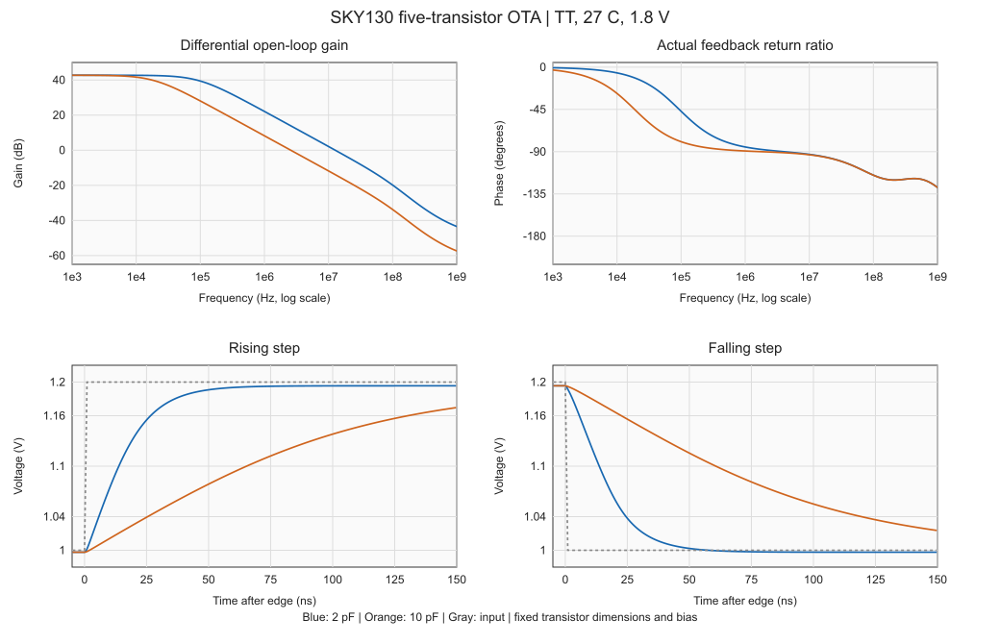

# 案例：SKY130 五管单级 OTA

这是一个用来演示这套骨架的完整案例摘要：固定规格 → 实现候选 → 复核 → 记录边界。公开版只含规格、结果和图，不含原始波形与运行脚本。

## 做了什么

在新会话里，让 AI 设计一个五管单级 OTA（NMOS 输入对、PMOS 1:1 电流镜负载、NMOS 尾管），工艺为开源 SKY130，仿真用 ngspice-46。库里已有的放大器尺寸方法、诊断套路、验收方法和器件数据表，被先读取、再复用；输入对、镜像、尾管的预算则针对这个新拓扑重新推导。

## 固定规格（仿真前写入，完整版见 [spec.json](spec.json)）

| 指标 | 门槛 |
| --- | --- |
| 低频增益 | ≥ 35 dB |
| 差模开环单位增益频率 | ≥ 5 MHz |
| 实际单位反馈下的相位裕度 | ≥ 60° |
| 双向 20–80% 平均摆率 | ≥ 5 V/µs |
| 静态总电流 | ≤ 150 µA |
| 各管静态饱和余量 | ≥ 0.05 V |
| 静态及阶跃终值误差 | ≤ 10 mV |

条件：TT、27 °C、1.8 V、负载 2 pF、理想偏压源。

## 预算

- 输出主极点近似：`gm_eff ≥ 2π × 5 MHz × 2 pF ≈ 62.8 µS`。
- 摆率电流下界：`5 V/µs × 2 pF = 10 µA`。
- 但 0.2 V 一阶响应的 20–80% 平均速度，要达到 5 V/µs 需要约 9.2 MHz 的闭环速度，对应约 115 µS 的跨导。所以不能只按 5 MHz 的带宽下限定电流。

## 结果

| 候选 / 条件 | 低频增益 dB | 单位增益频率 MHz | 相位裕度 ° | 摆率 ↑/↓ V/µs | Idd µA | 结论 |
| --- | ---: | ---: | ---: | ---: | ---: | --- |
| seed，2 pF | 42.73 | 12.74 | 86.1 | 5.75 / 6.38 | 18.2 | 全部通过 |
| speed，2 pF | 42.74 | 25.06 | 83.2 | 11.42 / 12.50 | 36.4 | 全部通过 |
| long_mirror，2 pF | 44.29 | 22.26 | 72.2 | 11.63 / 11.05 | 36.4 | 全部通过 |
| seed，10 pF，尺寸偏压不变 | 42.73 | 2.58 | 约 89.5 | 1.14 / 1.24 | 18.2 | 违反速度门槛 |

10 pF 一行是受控诊断：只改负载，速度约降为 1/5，说明输出电容主导速度。它不按原规格通过，也没有放宽阈值。半步长（0.25 ns）复跑，摆率变化约 0.003%–0.008%，终值变化远小于 0.1 mV。

## 复核是怎么做的

- 另写一份复核程序，用不同的读取方式，从原始波形重新判定，核对文件摘要、拓扑、关键节点电流守恒，并比较半步长结果。
- 另做小信号微扰，交叉检查有效跨导、输出电阻和直流增益，一致。
- 一个故意放大的负载被验收器正确识别为失败。

## 没有覆盖的

- 复核由同一执行上下文完成，**不是独立评审**。
- 只覆盖 TT、27 °C 的原理图，理想偏压，未测 PVT、失配、噪声、电源抑制、输入输出范围、真实偏置电路、版图和寄生。
- 上述通过只对本规格和本模型成立。

## 对应骨架里的哪些规则

| 做法 | 出处 |
| --- | --- |
| 规格在仿真前写下，改规格要重新核对旧结论 | [[Handoff and Verification#任务状态与恢复]] |
| 复核另写程序，并保留负例 | [[Handoff and Verification#Friday 的检查次序]] |
| 经验按「触发场景｜怎么做｜边界」归位 | [[Memory#任务收尾]]、[[Circuit Experience]] |
